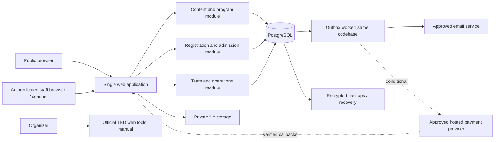

# 08 — Proposed technical architecture

Status: ADR-01 proposal, not an existing stack. Evidence: no app/configuration artifacts in [inspection](01-event-facts-and-sources.md). Existing PDFs and artwork will be reviewed as source material, not copied wholesale into public hosting.

## Options evaluated

| Option | Fit | Tradeoff / decision |
|---|---|---|
| Static public site + approved external registration/scanner + restricted operations documents | Lowest custom operational surface | Strong fallback if engineering capacity is small; must verify vendor privacy, geography, cap and exports |
| Django modular monolith + PostgreSQL + templates + small scanner JavaScript | Integrated internal workflows, mature ORM/forms/auth; limited frontend complexity | **Provisional recommendation** if team can maintain Python and hosting is approved |
| TypeScript/Next.js modular monolith + PostgreSQL + ORM/auth library | Reasonable if team already works in TypeScript/React | No evidence this preference exists; auth, jobs and admin tooling still need deliberate integration |
| SPA + independent API + several backend services | More deployment/auth/configuration boundaries | Not justified by 100 attendees and current timeline |

Django's authentication system provides users/groups/model permissions; department/object authorization remains application work ([official authentication documentation](https://docs.djangoproject.com/en/5.2/topics/auth/default/)). Its transaction API supports atomic service boundaries ([transaction documentation](https://docs.djangoproject.com/en/5.2/topics/db/transactions/)). Next.js is a valid alternative, not an existing dependency; its own [authentication guide](https://nextjs.org/docs/app/guides/authentication) distinguishes authentication, session management and authorization. Team skill, maintainers and deployment support must resolve ADR-01 before code generation.

No exact package versions or hosting vendor are approved. Select a supported Django release/patch, compatible Python and PostgreSQL versions during Phase 1, document support windows, and lock dependencies. Reading versioned documentation during discovery does not install or pin that version.

## Proposed boundaries

The worker is a process/command from the same deployable codebase, not a separate microservice. No Redis, Kafka, Kubernetes, Elasticsearch, data warehouse or separate CMS service is required initially. Public content can be cached; admissions and permissions cannot rely on stale cache.

## Component decisions to approve

| Concern | Proposed implementation | Acceptance / boundary |
|---|---|---|
| Frontend | Server-rendered semantic HTML/templates, simple responsive CSS tokens, progressively enhanced forms | Core public pages and manual search work without camera; no artwork text as sole page content |
| Backend | Django modules: identity, content, admissions, operations, program, audit | Business mutations go through services that enforce scope/transactions; generic admin cannot bypass capacity |
| Database | Managed PostgreSQL if approved; otherwise supported university-hosted PostgreSQL with named operator | Constraints, event-row locking, backup/restore and connection limits tested |
| ORM | Django ORM and versioned migrations | Use real transaction locks; custom SQL only where justified and tested |
| Authentication | Invite-only staff; mature maintained auth components; optional approved OIDC institution identity | University SSO is unverified. No custom password crypto or invented TED login federation |
| MFA | Maintained MFA implementation or approved identity provider | Organizer/admin/technical access protected; library/provider selected during foundation gate |
| Authorization | Application service/query policy with event/department scope | Framework model permissions alone insufficient; document 05 is mandatory |
| Validation | Server forms/schema validation plus database constraints; client validation for feedback | Explicit lengths, formats, status transitions and allowed fields; reject mass assignment |
| Storage | Private object storage or university-managed equivalent; public assets explicitly separated | Short-lived downloads; upload quarantine; geography approved. Large talk videos stay in approved production storage |
| Email | Approved transactional SMTP/API, authenticated sender domain | DNS/SPF/DKIM/DMARC checked; queue, retries, suppression/bounce handling; no provider selected |
| QR generation | Local library producing standard QR from opaque credential | Confirm library maintenance/license, quiet zone and scan readability in prototype |
| Scanner | Small browser JS decoder using camera API, with manual-search fallback | Select maintained decoder after iOS/Android prototype; do not rely only on native BarcodeDetector |
| Jobs | Database outbox and periodically invoked worker with leases | Idempotent job keys; bounded retry/backoff; stalled lease reclaimed; alert on dead letters |
| Payments | Disabled module boundary until paid gate | Hosted checkout and verified server events; no card fields or SDK assumptions |
| Deployment | One approved HTTPS application host, one database, private storage; worker from same release | No dependency on a sleeping/free tier during admission window; budget and region unconfirmed |
| Monitoring | Structured redacted logs, health probes, exception capture and operational counters | Alert routing to named lead/backup; no raw tokens/email/body capture |
| Backups | Encrypted database plus object manifests, isolated recovery copy and restore rehearsal | NFR-06; audit and admission reconciliation before reopening |
| Testing | Framework unit/integration tests plus browser E2E and physical-device rehearsal | PostgreSQL in integration environment; no SQLite-only concurrency evidence |

## Data ownership and integrations

App owns registrations and tickets only if model A/C is approved. Under model B the provider owns them, and any local copy is explicitly a reporting mirror. Shared operations documents can own tasks/rosters if those modules are deferred; do not create competing writable copies. Keep an ownership table in the implementation README and name a cutover time for migrations.

TED event page, licence portal, media uploader and survey resources are manual organizer tools (S01/X03–X05). Store links/completion references, not passwords. No TED API or university API discovered. Map is an approved outbound link initially; an embedded map requires additional privacy/performance consideration. No analytics/tracking, WhatsApp/SMS API, CRM or marketing synchronization by default.

## Sessions, requests and jobs

Same-origin browser sessions with Secure/HttpOnly/SameSite cookies, CSRF protection and no permissive credentialed CORS. All service endpoints enforce scope independent of UI. Authentication cookie/session IDs must not enter logs. Staff offboarding invalidates sessions and grants.

Jobs use `event_id`, immutable business reference, unique idempotency key, status, attempt count, next-attempt time, lease expiry and safe error code. Retries proposed at 1, 5 and 15 minutes then hourly, maximum 6 attempts; operational owner can retry after correcting cause. Exactly-once email is not promised. A job cannot act on stale cancelled tickets or publish a superseded approved revision.

For file imports and exports use bounded job/file sizes and an explicit result report. Do not parse uploaded spreadsheets with macros or auto-fetch arbitrary URLs. External references are links for authorized humans, not automatic server-side URL fetches.

## Deployment/configuration proposal

Proposed application directory: `platform/`, leaving existing private sources outside the public/static root. Git initialization, remote creation and deployment are later implementation tasks. Before any public repository is created, exclude private correspondence, contracts, registrations and temporary exports; default private repository.

Configuration categories only: database connection, application secret, allowed host/origin, approved email sender/provider secret, private storage, credential encryption key, optional identity provider and optional payment webhook secret. Future `.env.example` contains placeholder names only. Secrets are held in the approved deployment secret store, not source files. Separate development, staging and production data, domains and secrets; staging uses synthetic identities and disabled/test delivery.

Release pipeline proposal: formatting/static analysis → tests → dependency/secret checks → migration review → staging smoke and authorization check → backup → deploy compatible migration/application → smoke and rollback readiness. Preserve old/public content on failed release. Follow the framework [deployment checklist](https://docs.djangoproject.com/en/5.2/howto/deployment/checklist/) as a baseline, including secure production configuration; this is not proof a deployment is already secure.

## Dependency and fallback decision

If staffing/hosting/MFA selection is unresolved by 20 September, prioritize a reviewed public site and an approved external registration system. If atomic admissions/mobile tests fail by 11 October, freeze custom feature expansion and adopt the rehearsed external/manual route. Do not introduce a new authentication or ticket provider in the final 48 hours except as an approved incident response with a tested migration path.
