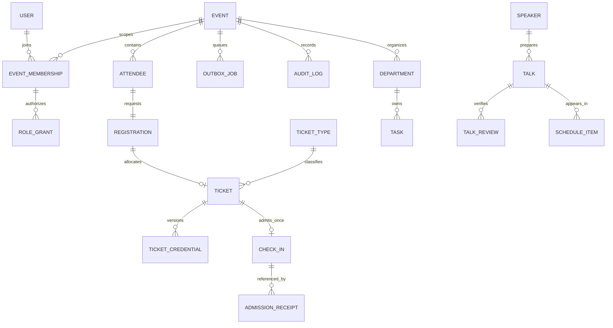

# 09 — Initial relational data model

Status: proposed logical model, not migrations. Supports custom-free baseline; conditional/deferred entities are explicitly marked. Detailed specification is broader than the first implementation slice: **create tables only when their phase is approved**.

## Conventions and universal constraints

- Business primary keys: UUID `id`. All mutable business rows have `created_at`, `updated_at` (timezone-aware), and integer `version` for optimistic edits. Append-only rows have `created_at` and explicit event/occurrence time; never overwrite history with client timestamps.
- Event-owned tables contain `event_id FK Event`. In addition to PK, add `UNIQUE(event_id,id)` where composite referencing is used. Every cross-table event-owned relationship uses composite FK `(event_id, target_id)` or an equivalent enforced database design; application checks alone must not permit cross-event links.
- Index foreign keys used in joins; specifically list significant compound indexes below. Status columns have enumerated CHECK constraints. Defaults do not publish records or grant access.
- `S0`: no routine soft deletion; use explicit cancellation/withdrawal/archive status. `S1`: drafts may have `archived_at` with restrictive FK checks. Retention erasure/anonymization is independent of these status controls. No universal `deleted_at` on every table.
- `P1`: public approved data; `P2`: private operational personal data; `P3`: restricted evidence/financial/security data. Public serializers select fields, never dump entire ORM records.
- Ordinary mutable records use the timestamp/version convention; audit, receipts and admissions are append-only. Nullable subject links after approved anonymization preserve operational counts without retaining identity indefinitely.

## Core launch entities

| Entity / phase | Fields and relationships (besides conventions) | Unique/check constraints and indexes | State / deletion / privacy |
|---|---|---|---|
| Event — foundation | canonical_name, public_slug, starts_at, ends_at, timezone, venue_display, venue_status, licence_reference, licensed_capacity, allocation_limit, entry_mode | UQ(public_slug); end>start; 0<=allocation_limit<=licensed_capacity; baseline ceiling 100; no non-approved ceiling increase | draft/planning/registration_open/ready/live/completed/archived; S0; public subset P1, licence reference P3 |
| EventSettings — foundation | event_id PK/FK, registration_opens/closes, allocation_mode, locale configuration, approved_policy_version, doors_at nullable, promotions_cutoff, contact_public | 1:1 Event; closes>opens; explicit approval required; no schema-free settings bag for cap/auth | validated typed fields; S0; P1/P2 |
| User — foundation | email_original, email_normalized, display_name, authentication subject/password hash, active flag | UQ(email_normalized); UQ(identity_provider,subject) when federated; no plaintext passwords | active/suspended; S0; P3; purge/anonymize after grants end per policy |
| EventMembership — foundation | event_id, user_id FK User, status | UQ(event_id,user_id); IDX(user_id,status) | invited/active/suspended; S0; P2 |
| Role / Permission — foundation | predefined code and permission code; RolePermission relation | UQ(code), UQ(role_id,permission_id); controlled catalog/migration | no event-user editable permission language; S0; P2 |
| RoleGrant — foundation | event_id, user_id, role_id, department_id nullable, granted_by, reason, expires_at | event membership FK; scoped UQ(event,user,role,department) plus partial UQ for null department; scoped role requires department; IDX(user,event,expires_at) | active/revoked via timestamps; S0; P3 |
| StaffInvitation — foundation | event_id, invited_email, intended_role request, token_digest, expires_at, used_at, invited_by | UQ(token_digest); IDX(event,expires_at); consumption locked; invitation alone not grant | pending/used/revoked/expired; S0; P3; delete token digest after retention |
| ContentRevision — website | event_id, page_key, locale, revision, structured/body content, approved_by/at, published_at, previous_revision_id | UQ(event,page_key,locale,revision); one published pointer per page/locale; IDX(event,status) | draft/review/approved/published/archived; S1 drafts; P1 published, P2 drafts |
| Attendee — registration | event_id, name, email_original, email_normalized, verification_at | UQ(event,email_normalized); IDX(event,name); no global cross-event person database | current/anonymized; S0; P2 |
| Registration — registration | event_id, attendee_id, submitted_at, eligible_at, waitlist_sequence, status, policy_version | UQ(event,attendee_id); UQ(event,waitlist_sequence) when assigned; IDX(event,status,eligible_at,id) | unverified/pending/waitlisted/confirmed/rejected/withdrawn/cancelled; S0; P2 |
| ActionToken — registration | event_id, attendee_id, purpose, token_digest, expires_at, used_at | UQ(token_digest); purpose allowlist verification/view/manage; IDX(expires_at) | consumed/revoked/expired timestamps; S0; P3; never reused as QR |
| TicketType — registration | event_id, code, name, enabled; optional allocation quota approved later | UQ(event,code); default single GENERAL; quota nonnegative and no hidden extra cap | enabled/disabled; S0; P1 name |
| Ticket — registration | event_id, attendee_id, registration_id, ticket_type_id, booking_reference, allocated_at, cancelled_at/reason, expires_at | UQ(event,attendee_id), UQ(event,registration_id), UQ(event,booking_reference); IDX(event,status); cap enforced through event lock, not cross-row CHECK | active/cancelled/expired; S0; P2. Reinstatement must recheck cap; no second row for same attendee |
| TicketCredential — registration | event_id, ticket_id, digest, generation, encrypted_delivery_material, encryption_key_id, expires_at, revoked_at | UQ(digest); UQ(ticket_id,generation); partial UQ(ticket_id) WHERE revoked_at IS NULL; IDX(event,digest) | active/revoked/expired; S0; P3; effective expiry validated even before cleanup |
| CheckIn — admission | event_id, ticket_id, actor_id FK User, device_label, admitted_at, recorded_at, source, manual_ledger_row_id nullable | UQ(event,ticket_id); partial UQ(event,manual_ledger_row_id); IDX(event,admitted_at); actor and source mandatory | permanent first admission; S0; P2/P3. Controlled correction record does not erase it |
| AdmissionReceipt — admission | event_id, actor_id, request_id, payload_digest, result_code, checkin_id nullable, safe result snapshot | UQ(event,actor,request_id); IDX(created_at); fingerprint mismatch rejected | append-only; S0; P3; no raw QR |
| OutboxJob — registration/foundation | event_id, kind, business_reference, dedupe_key, encrypted/minimal payload, attempts, available_at, lease_until, provider_reference, safe_error | UQ(dedupe_key); IDX(status,available_at), IDX(lease_until); attempts>=0 | pending/processing/sent/failed/cancelled; S0; P3; purge payload independently of metrics |
| NoticeReceipt / Consent — registration | event_id, attendee_id or volunteer_application_id, notice_version, purpose, state, captured_at, withdrawn_at | exactly one subject; UQ(subject,notice_version,purpose) with properly scoped partial indexes; IDX(event,purpose,state) | consent separate from notice acknowledgment; S0; P3 |
| AuditLog — foundation | event_id, actor nullable/system actor, action, target_type/id, request_id, safe before/after summary, result | IDX(event,created_at), IDX(event,target_type,target_id), IDX(actor,created_at); application DB role denies UPDATE/DELETE | append-only; S0; P3; approved anonymization process separate from app CRUD |
| ImportBatch / ExportJob — registration | event_id, actor_id, kind, content_hash, state, purpose, approved_columns, row_count, expires_at, file_id nullable | UQ(event,kind,content_hash) for import identity; IDX(event,created_at), IDX(expires_at) | staged/committed/failed or pending/ready/expired; S0; P3 |
| File — website/internal documents | event_id, owner_id, storage_key, filename, mime, byte_size, checksum, classification, scan_state, version, retention_until | UQ(storage_key); size limit; IDX(event,classification), IDX(retention_until); entity links in typed join tables | quarantined/available/rejected/archived; S1 draft only; P1 approved public asset, otherwise P2/P3 |
| PrivacyRequest — registration | event_id, subject_ref, verified_at, request_kind, owner_id, due_at, resolution_ref, hold_reason/expiry nullable | IDX(event,status,due_at); require identity verification before disclosure | received/verifying/in_progress/fulfilled/declined; S0; P3 |

Session, password reset and MFA tables follow the selected maintained authentication component's schema and migration lifecycle. Their exact fields are deferred until ADR-04 implementation selection; do not create a parallel custom identity store. Session secrets and MFA recovery codes are never public app data.

Migration dependency: if department-scoped grants are enabled in foundation, create the minimal Department table before RoleGrant. Otherwise add its nullable foreign key and scoped grants in the operational-extension migration; do not create a foreign key to an absent table. Similarly, add volunteer consent subject links only when the volunteer module is enabled. After approved attendee anonymization, remove email/name and retain a non-identifying internal record; use nullable email with a partial uniqueness constraint on non-null normalized email, rather than a repeated fake email value.

## Pre-event operational extensions — or external records

These entities define the integrated option. If a shared-document workflow is approved, maintain the same meanings in those records without creating unused tables.

| Entity | Fields / relationships | Constraints and indexes | Lifecycle / privacy |
|---|---|---|---|
| Department | event_id, name, code, active, operational_contact_ref | UQ(event,code); IDX(event,active) | archive only after assignments move; S1; P2 |
| DepartmentMembership | event_id, department_id, user_id, supervisor_id, status | UQ(event,department,user); all event memberships valid; IDX(event,user,status) | active/ended; S0; P2; leadership uses RoleGrant |
| VolunteerApplication | event_id, email/name, availability, skills, preference_id, reviewer_id, private_note, decision_at | UQ(event,email_normalized); IDX(event,status,preference_id); bounded fields | submitted/review/waitlisted/accepted/rejected/withdrawn; S0; P2/P3 notes |
| VolunteerProfile | event_id, user_id nullable, application_id nullable, display_name, contact_route, status | UQ(event,user_id) where not null; UQ(application_id) where not null; account optional | active/withdrawn/archived; S0; P2 |
| VolunteerDepartment | event_id, volunteer_id, department_id, supervisor_id | UQ(event,volunteer,department); scoped FK to departments/profiles; account membership mirrors only when account exists | active/ended; S0; P2 |
| Shift / ShiftAssignment | Shift: event/department/start/end/location/required_skill; Assignment: shift, volunteer, briefing_at, acknowledged_at, arrived_at, supervisor | end>start; UQ(shift,volunteer); IDX(volunteer,start) via assignment query; overlap prevented transactionally by locking volunteer profile | assigned/acknowledged/absent/completed/cancelled; S0; P2 |
| Task | event_id, department_id, assignee_id, creator_id, title, due_at, critical, status, blocked_reason, evidence_file_id/ref | IDX(event,department,status,due_at), IDX(assignee,due_at); completion evidence required for critical tasks | backlog/in_progress/blocked/review/done/cancelled; S1 drafts; P2 |
| TaskDependency | event_id, task_id, depends_on_id | UQ(task,depends_on); task!=depends_on; cycle check with serialized graph mutation; index reverse dependency | no status; controlled remove+audit; P2 |
| Speaker | event_id, name, private_contact, affiliation, public_bio, photo_file_id, public_approval_ref | IDX(event,name); no unique-name assumption; public fields versioned via content | candidate/selected/reserve/withdrawn; S1 candidates; P2/P3 contacts |
| Talk | event_id, speaker_id, title, idea, language, duration_seconds, script_file_id, version, release_file_id, preparation_state | duration>0 and <=1080 for approved talks; IDX(event,preparation_state); public approval separate | idea/outline/draft/review/rehearsal/ready/withdrawn; S0; P2/P3 |
| TalkReview / Rehearsal | event_id, talk_id, reviewed_version, reviewer_id, check_kind, result, evidence_ref; rehearsal scheduled_at/measured_seconds/technical_notes | IDX(talk,reviewed_version,check_kind); UQ(talk,version,check_kind,reviewer) where useful; approval requires all mandatory checks | pending/passed/changes_required; append new version; P3 |
| ScheduleItem | event_id, revision, starts_at, ends_at, kind, talk_id nullable, public_title, public_flag | end>start; IDX(event,revision,starts_at); approved schedule overlap checked under event/revision lock | draft/published/archived revision; P1 subset/P2 internal |
| RunbookRevision / RunbookEntry | event/revision/approved_by/at; entries with time, sequence, cue, owner, technical needs, source schedule revision | UQ(event,revision); UQ(revision,sequence); immutable once approved; IDX(revision,starts_at) | draft/approved/superseded; S0; P2/private contacts P3 |
| Incident | event_id, department_id nullable, actor, owner, severity, status, location, safe summary, escalation_at, resolved_at | IDX(event,status,severity), IDX(owner,status); no diagnosis fields | open/acknowledged/in_progress/resolved; S0; P2/P3 restricted notes |
| Announcement / Acknowledgment | event, author, audience_kind/department, body, published_at, expires_at; acknowledgment user/time | UQ(announcement,user); IDX(event,published_at); audience enforced server-side | draft/published/expired; S1 drafts; P2 |
| EntryModeTransition / ManualLedgerRow | event, from/to mode, supervisor, epoch, timestamp; row with booking_ref, actor, local_entry_time, reconciled_checkin_id | UQ(event,epoch,row_id); IDX(event,epoch); immutable imported ledger reference | declared/reconciling/closed; append-only; P3 |
| Movement (conditional re-entry) | event, ticket_id, type exit/reentry, actor, occurred_at, request_id | UQ(event,actor,request_id); ordered state transitions under event/ticket lock | append-only; S0; P2; CheckIn remains permanent |

Use typed links such as `TalkFile`, `TaskEvidenceFile`, `ContentAsset` and `ExportFile` with composite FKs instead of an unvalidated polymorphic file owner. Physical production recordings remain outside the application storage by default; store approved location/reference and rights readiness, not massive video blobs in PostgreSQL.

## Conditional paid extension — do not migrate for free registration

| Entity | Important fields | Integrity / privacy |
|---|---|---|
| Order | event, attendee, total_minor_units, currency, status, merchant_ref | UQ(provider,external_order_ref); integer nonnegative amounts; IDX(event,status); P3; accounting retention approved independently |
| SeatHold | event, order, ticket_type, expires_at, converted_ticket_id | UQ(order); no expired hold counted; event lock governs expiry/conversion; IDX(event,expires_at) |
| PaymentAttempt | order, provider, transaction_ref, expected_amount/currency, state, verified_at | UQ(provider,transaction_ref); order FK scoped; no card/bank credential fields |
| PaymentEvent | provider,event_external_id, event/order refs, signature_verified_at, payload_digest, processed_at | UQ(provider,event_external_id); safe minimal event payload; IDX(processed_at) |
| Refund | order/payment, amount_minor_units, reason_code, approved_by, provider_ref, state, idempotency_key | UQ(provider_ref) where set, UQ(idempotency_key); sum successful+pending refunds <= refundable balance under order lock |

Soft deletion is not used for financial records. Retention and legal holds are controller/merchant decisions. Future provider contracts determine additional required fields; never store full raw webhook bodies indefinitely by default.

## Relationship overview

Diagram is abbreviated; the tables define scope and nullable relationships. In particular rejected receipts may have no CheckIn, and users/volunteers need not be attendees.

## Critical integrity tests

Reject cross-event FKs, duplicate credentials, duplicate active credential per ticket, duplicate admission, duplicate request ID with a new payload, allocation past limit, negative/over-refunded amounts, cyclic dependencies and overlapping volunteer shifts. Retention must not permit a restored revoked QR or deleted consent to regain validity: apply post-backup erasure/revocation records before reopening (NFR-06).
